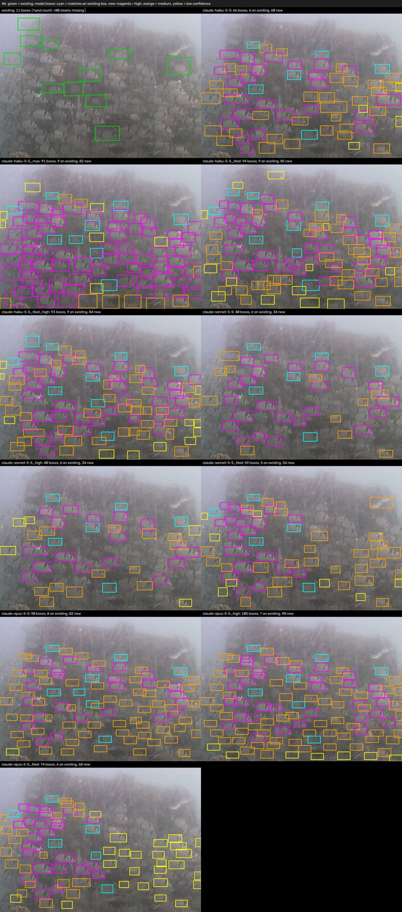
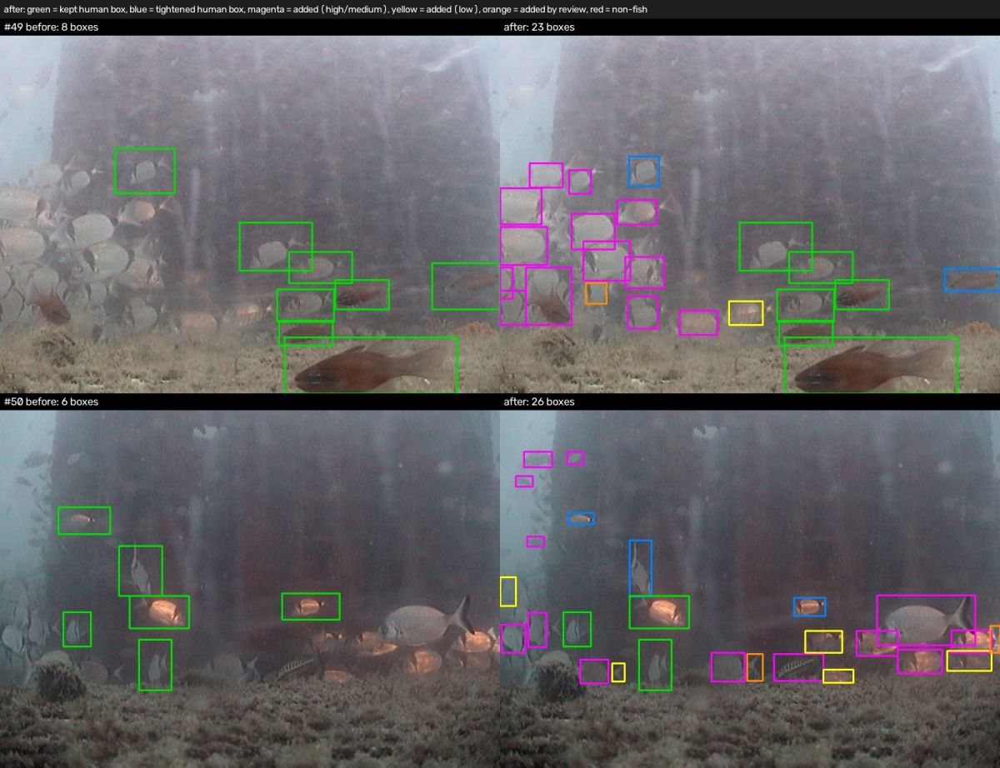
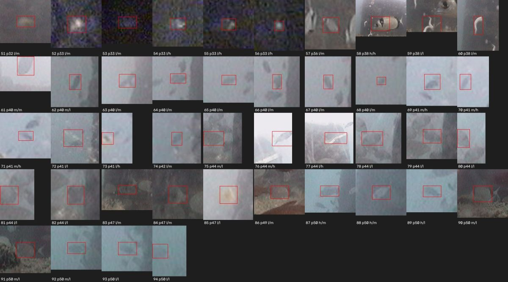
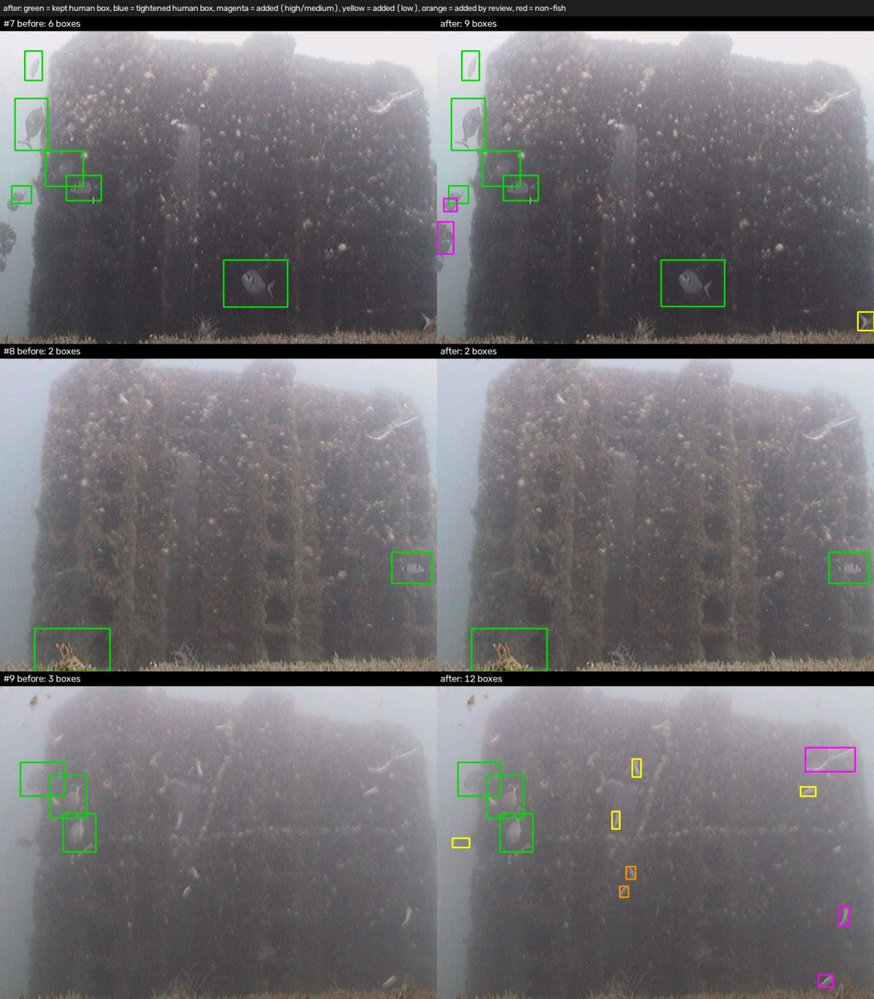

# VLM pre-annotation of obsea_2013_2014

The [obsea_2013_2014](../../datasets/obsea_2013_2014.py) annotations (PANGAEA 946149) are incomplete:
in a hand count on 40 random photos about 60% of the visible fish have no box, mostly in schools,
and many human boxes are loose. Human annotators will review and clean the whole dataset; these
scripts pre-annotate it with Claude models first, to cut that work. Deleting a wrong box is quicker
than drawing a missing one, and a tightened box only needs a glance, so the pipeline favours adding
candidate boxes and marks how sure it is about each one.

## Pipeline

1. **Pass 1** (`pilot.py`, variant `claude-haiku-5-5_tiled_v2`): Claude Haiku 5.5 (effort medium)
   looks at each photo in 4 overlapping tiles (384x288 px, sent upscaled 3x) and returns a box, a
   class (fish / non-fish, following the dataset's annotation rules) and a confidence
   (high / medium / low) for every animal. Each tile keeps the boxes centred in its quadrant;
   duplicates are suppressed.
2. **Pass 2** (`second_pass.py`, reviewer `review_haiku_v2`): Claude Haiku 5.5 sees the photo
   (2x) with every box drawn and numbered, human boxes in green and pass-1 boxes in yellow, and
   the checklist of annotation problems (missing, extra, loose, two animals in one box, wrong
   class, unusable photo). For each box it answers keep, fix (new box and/or class) or remove,
   then lists the animals still missing. Photos with more than 20 boxes are reviewed in the same
   4 tiles (3x).
3. **Merge** (`second_pass.final_annotation`, policy `protect`): human boxes stay fish and are only
   removed on a high-confidence verdict (never happened in the test photos); the review may
   remove a pass-1 box only if pass 1 gave it low confidence (see the 50-photo test below).
4. **Export** (`export.py`): COCO for the annotators, see [Outputs](#outputs).

`batch_run.py` runs pass 1, pass 2 and the export on the Message Batches API at half price.
Requests carry their image inline, so they are split into batches of at most 200 MB (the API
limit is 256 MB); every stage is resumable and failed requests are resubmitted (3 attempts).

## Pilot results

All numbers below come from `pilot_results/`.

### Which model (9 hand-counted photos)

9 photos with 67 human boxes and 175 clearly visible fish without a box (`pilot9_images.tsv`).
"Existing found" = human boxes the model found again; "new" = model boxes on no human box, by
confidence. Full table: `pilot9_scores.json`; a hand check of new boxes: `pilot9_new_box_judgments.json`.

| variant | existing found | new high / medium / low | full dataset, Batch API* |
|---|---|---|---|
| Haiku 5.5, whole photo | 64% | 39 / 52 / 35 | $5 |
| Haiku 5.5, whole photo, effort max | 82% | 87 / 45 / 44 | $45 |
| **Haiku 5.5, 4 tiles, prompt v2 (pass 1)** | **82%** | **27 / 71 / 48** | **$17** |
| Sonnet 5.5, whole photo | 81% | 41 / 39 / 29 | $88 |
| Opus 5.5, whole photo | 93% | 50 / 89 / 38 | $246 |
| Opus 5.5, 4 tiles | 87% | 47 / 47 / 67 | $510 |

\* extrapolated from these 9 crowded photos, so higher than for typical photos (see the cost
analysis). Opus finds the most fish, but tiled Haiku gets most of the way at a fifteenth of the
cost. In a hand check, all of its high-confidence and most of its medium-confidence new boxes
were on fish, and about half of its low-confidence ones. Tiling helps more than effort: whole-photo
Haiku boxes in schools are often offset.



### Both passes on 50 random photos

50 random photos (`random50_images.tsv`), judged one by one on before/after sheets
(`random50_judgments.json`): **39 better, 8 unchanged, 3 worse**. With the `protect` merge,
the 250 human boxes become 447 (`random50_export_summary.json`):

- 174 human boxes unchanged, 76 tightened by the review (about a third of them were loose)
- 177 boxes added by pass 1 (51 high, 71 medium, 55 low confidence), 20 added by the review
- 66 low-confidence pass-1 boxes removed by the review, kept aside as rejected candidates



What went wrong, and what changed because of it:

- **The review removed real fish.** Of the 94 pass-1 boxes it removed, about 35 were clearly fish
  and 18 probably fish, against 12 correct removals (the rest unclear). The `protect` merge now
  lets it remove only low-confidence boxes, which are a coin flip either way.
  
- **A fish relabelled as non-fish** (a human-boxed damselfish): human boxes now always stay fish.
- **A big fish dropped by the merge**: pass 1 boxed it, but its box contained a small human box
  and was taken for a duplicate. A pass-1 box more than 4x the area of a human box inside it is
  now a different animal.
- **Still open:** low-confidence boxes on white drifting filaments in 3 of the 50 photos, and a
  few clearly visible fish that neither pass boxed (for example a large bream cut by the photo
  edge).



## Cost analysis

Prices (USD per million input / output tokens): Claude Haiku 5.5 $0.10 / $0.50, Sonnet 5.5
$2 / $10, Opus 5.5 $4 / $20; the Batch API halves them. Thinking tokens count as output.

| | per photo | 14,952 photos | with the Batch API |
|---|---|---|---|
| Pass 1 (4 tile requests) | $0.00162 | $24.3 | $12.1 |
| Pass 2 (1 request, 4 if crowded) | $0.00132 | $19.7 | $9.9 |
| **Both passes** | **$0.00294** | **$44.0** | **$22.0** |

- Measured on the 50 random photos with the standard API (`pilot.py` / `second_pass.py`), then
  multiplied by the 14,952 photos. A small Batch API run of both passes on 12 other photos
  (4 of them crowded) measured $0.0285 ($0.00237 per photo): all 75 requests succeeded, and
  each pass's batch finished in about 3-4 minutes. That sample was picked a third crowded, so it
  costs more per photo than the random 50 ($0.00147 per photo at Batch API prices).
- Expect roughly $18-28 for the full run: a crowded photo costs about 1.6x a sparse one in
  pass 1 and up to 4x in pass 2, and the share of crowded photos in the sample is uncertain.
- Pilot spend so far: $2.43 for the model comparison, the prompt and review iterations, the
  50-photo test and the batch test.
- The request images are uploaded with the batches: about 10 GB for pass 1 (59,808 tiles, about
  52 batches) and 5 GB for pass 2. Batches usually finish within an hour, at most 24 hours.
- For the annotators, the 50-photo test suggests: 17 of 50 photos at check priority 0 (only
  unchanged or tightened human boxes and high/medium-confidence model boxes), 20 at 1-4, 13 at 5
  or more.

## Running it

```bash
python3.11 -m venv venv-vlm
venv-vlm/bin/pip install -r tools/vlm_annotation/requirements.txt
# ANTHROPIC_API_KEY=... in .env (git-ignored); data/processing/obsea_2013_2014 must exist
venv-vlm/bin/python tools/vlm_annotation/batch_run.py run      # waits for the batches: use tmux or nohup
venv-vlm/bin/python tools/vlm_annotation/batch_run.py status   # from another shell
venv-vlm/bin/python tools/vlm_annotation/batch_run.py cost
```

`venv-vlm` is separate from the pipeline's `venv` because the Anthropic SDK needs a newer `idna`
than `roboflow` pins. `--images <tsv>` limits a run to some photos and `--run-dir` keeps runs
apart. A stopped run continues where it left off when started again.

## Outputs

In `data/vlm_annotation/obsea_2013_2014/export/` (git-ignored, like all data):

- `obsea_2013_2014_vlm_coco.json`: every photo and its final boxes, categories fish = 1 and
  non-fish = 2. Each annotation has `attributes`: `source` (human, vlm_pass1, vlm_review),
  `change` (unchanged, box_corrected, added), `confidence` (model boxes) and `original_bbox`
  (tightened human boxes). Each image has `vlm`: status, unusable, crowded, check_priority, counts.
- `rejected_candidates.json`: the low-confidence pass-1 boxes the review removed, per photo.
- `review_queue.csv`: photos sorted by `check_priority`, highest first.
- `summary.json`, and `../cost.json` with the measured tokens and cost.

`check_priority` counts the uncertain boxes of a photo (low-confidence model boxes,
medium-confidence boxes added by the review, rejected candidates), plus 3 if the photo is crowded
and 5 if it is unusable or could not be reviewed.

## Files

- `pilot.py`: pass 1 and the model/variant comparison (`run`, `score`, `render`, `review`)
- `second_pass.py`: pass 2, the merge policies and the before/after sheets (`run`, `render`, `final`)
- `batch_run.py`: both passes on the Batch API
- `export.py`: COCO export for the annotators
- `pilot_results/`: photo lists, hand counts, scores, judgments and figures of the pilot
